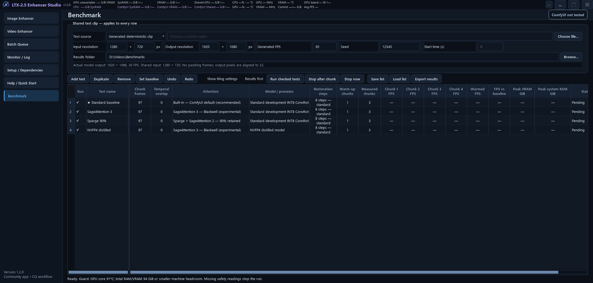
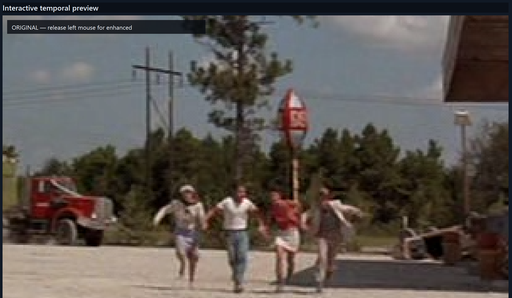
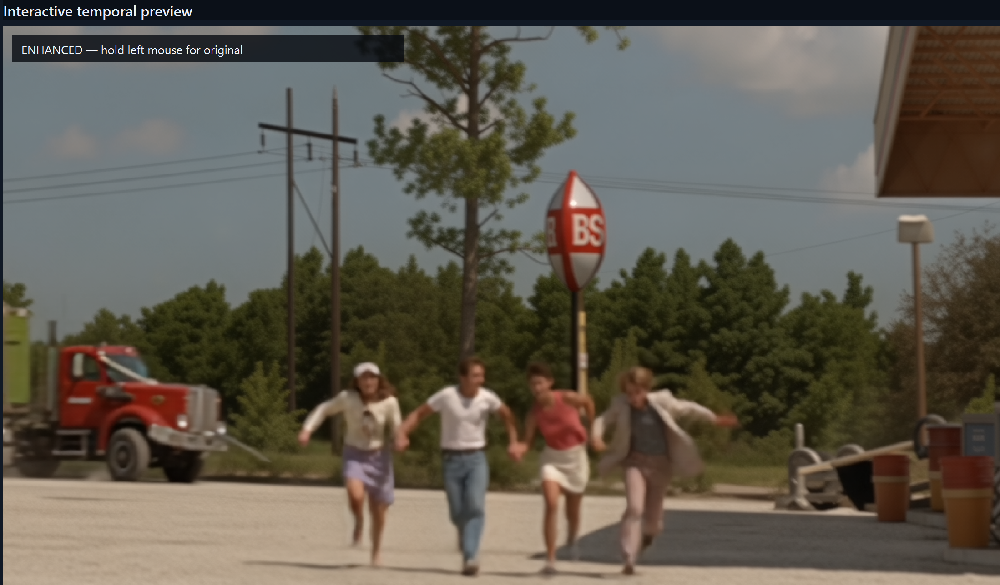

# LTX-2.5 Enhancer Studio

Restore videos and images with LTX-2.5 and CQdesign's enhancer LoRAs in a portable Windows app. Compare a short preview before processing a full video, or use the built-in Benchmark to find useful settings for your computer.

## Download

Download **[LTX25_Enhancer_Studio.exe](https://github.com/skv89/LTX-2.5-Enhancer-Studio/releases/tag/v1.2.0)**. Only the EXE is needed to start; no app installer is required. First-time setup downloads the AI engine, tools and models separately.

The EXE is unsigned, so Windows may show an unfamiliar-app warning. Use this repository's release and the accompanying **SHA256SUMS.txt** to verify your download.

## What's new in 1.2.0

| Feature | What it does |
| --- | --- |
| Benchmark tab | Compare chunk sizes, temporal overlap, attention, model/precision, restoration steps and separate encoding/decoding tiles. See every chunk's FPS, warmed FPS, percentage change from your saved baseline and peak memory in one table. |
| Optional attention backends | Adds SageAttention 3 and Sparge + SageAttention 2 on supported setups. Setup checks the selected engine's compatibility. Sparge lets you choose the percentage of attention blocks retained. |
| Model and speed controls | Choose Standard INT8 ConvRot or the experimental NVFP4 distilled model in Video Enhancer and Benchmark. Standard also offers experimental 6- and 4-step restoration. |
| Sound and subtitles | Copies all original audio and embedded subtitle tracks without re-encoding, keeping their order and track information. Automatically tries MKV when MP4 or MOV cannot hold them. |
| Better preview and guidance | Adds fullscreen preview, paired original/processed screenshots, source-video information and more specific hover help. |
| Everyday reliability | Fixes attention-menu editing, benchmark row alignment, saved baseline comparisons, ComfyUI startup and the Windows taskbar icon. Video model filenames are managed automatically so previews and production use the same selected model recipe. |

### Benchmark

Use a reproducible generated clip or your own video. Input/output resolution is shared by every test row. Edit a cell with one click, resize columns, drag rows into order, and use Delete, Ctrl+Z or Ctrl+Y. Chunk sizes round to the nearest value that avoids frame padding.

Warm-up chunks are marked **W** and excluded from warmed FPS. The baseline remains saved across runs until you replace it. **Stop after chunk** finishes the current chunk; **Stop now** cancels the current test. Recoverable row failures can move on to the next test; unsafe or unresponsive engine states stop the campaign.

The example below is an unrun test list, not a speed claim. Benchmark measures video processing without audio or the final delivery encode. Actual aligned output dimensions are shown above the table. Its peak memory columns include other running apps: total system RAM and total GPU memory, not just ComfyUI.

## Getting started

1. Open the EXE, go to **Setup / Dependencies**, and select **Set up automatically**. Review the download size and destination before continuing.
2. If requested, sign in to Hugging Face and accept the model's access terms using the supplied links.
3. Choose a video or image. Start with the standard settings.
4. For video, select **Render Temporal Preview** and compare with the original. Preview context is separate from the full-video chunk size.
5. Select **Add to Queue**, then **Start / Resume** in **Batch Queue**.

To update, close the old app before replacing its EXE. Keep your existing settings and engine. Open **Setup / Dependencies** and use **Verify All**; optional attention backends have their own check/install controls. Independently managed ComfyUI installations may need a separately approved repair.

## Choosing speed and quality

- **Built-in attention and Standard INT8 ConvRot** are the starting point. Optional attention is not faster for every chunk size or computer; compare warmed FPS on your own system.
- **NVFP4 uses a different, already-distilled model**, not just a lower-precision copy of Standard. It requires a compatible Blackwell setup and an additional model download. It uses 8 restoration steps and disables the extra distilled LoRA.
- **Fewer restoration steps and lower Sparge retention** can change detail or motion. Compare a representative preview before processing a long video.
- **Smaller chunks and tiles** can help with memory pressure. Larger chunks are not automatically faster. Encoding and decoding have separate tile controls.
- **Pre-downscale** can help reconstruct small or distant faces, but also removes source detail. Compare the original and enhanced result before choosing it.

## Sound and subtitles

Leave **Keep original audio and subtitles** on to preserve every source audio/subtitle track. If neither the chosen container nor MKV can copy a track, export stops with an error rather than silently dropping or converting it. Trims follow compressed-packet boundaries.

**Use audio to guide restoration** is a separate, optional AI setting and is off by default. When enabled, choose one source audio track to guide the picture. It is not audio cleanup or a guaranteed lip-sync fix; generated sound is never exported. This choice does not limit which original tracks are copied.

## Requirements and limitations

- 64-bit Windows, a supported NVIDIA RTX GPU and a working driver. Memory requirements depend on the model, resolution and chunk size; a particular low-memory card is not guaranteed by the high-memory test results.
- Allow roughly **135 GB** for standard first-time setup, plus space for media and working files. Optional models require more. Setup displays the actual downloads before confirmation.
- Some model downloads require Hugging Face access approval. Rendering requires **cuDNN 9.24.x**; automatic setup handles this for the app-managed engine.
- Optional Sage/Sparge backends require a matching GPU and Python/Torch/CUDA stack. Setup reports unsupported combinations instead of silently changing your installed Torch.
- **Benchmark specifically** requires a local ComfyUI engine, exactly one physical NVIDIA GPU using its default CUDA device 0, and working temperature/memory readings. Remote engines, multiple NVIDIA GPUs and remapped devices are not supported by Benchmark's safety monitor.
- Video processing uses 30 FPS internally. Matching the source frame rate is an optional final-output setting, not another AI pass.
- The FFV1 compatibility viewer supports seeking and still-frame comparison, not continuous Play.
- AI enhancement may change faces, lettering and textures. Check important details. No universal speed or quality improvement is promised.

## Preview examples

These previously published examples show the v1.1.0 interface; the v1.2.0 Benchmark screenshot above shows the newer layout.

### Original

### Enhanced

## Credits and licenses

An independent community application using [CQdesign's enhancer LoRAs and workflows](https://huggingface.co/CQdesign/LTX-2.5-CQ-Video-and-Image-Enhancer-LoRAs), LTX-2.5 and ComfyUI. Not affiliated with or endorsed by their authors.

The release includes **LTX25_Enhancer_Studio_1.2.0_ThirdPartyNotices.zip** with attribution, licenses and library-replacement instructions. The unchanged Qt/PySide/Shiboken and FFmpeg playback libraries use LGPL terms; their matching sources remain in **LTX25_Enhancer_Studio_1.1.0_ThirdPartySources.zip**, also attached to this release. The retained filename reflects unchanged library sources, not an old application download. These archives are not needed to run the app and do not contain this application's source code. Optional attention components retain their included Apache-2.0 and BSD notices; models and separately installed tools retain their own terms.
