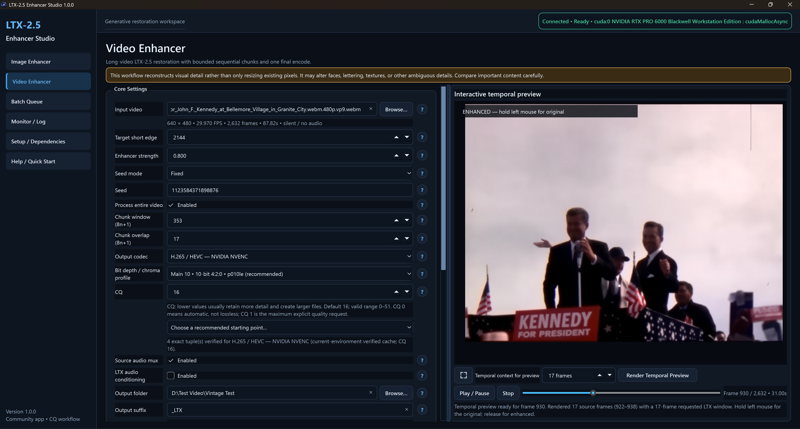
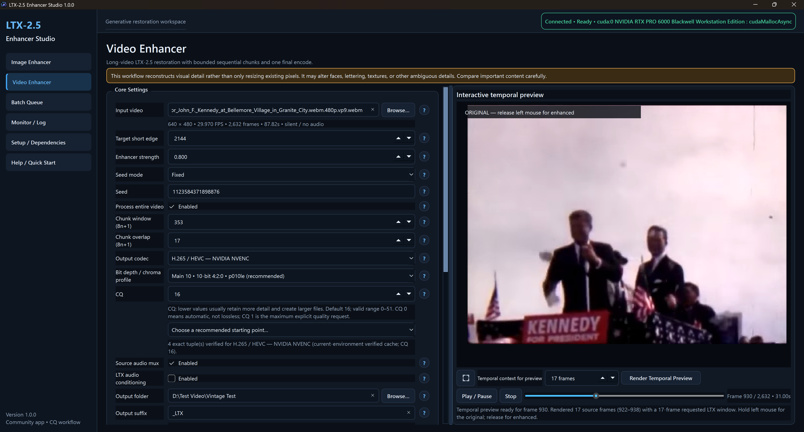
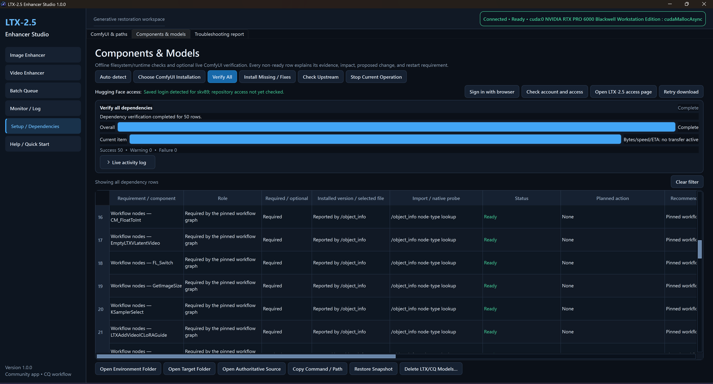

# LTX-2.5 Enhancer Studio

Enhance videos and images with LTX-2.5 and CQdesign's enhancer LoRAs in a portable Windows app. Preview a short section, compare it with the original, and queue full videos for processing.

## Download

Download **LTX25_Enhancer_Studio.exe** from the [v1.1.0 release](https://github.com/skv89/LTX-2.5-Enhancer-Studio/releases/tag/v1.1.0). No app installer is required.

Only the EXE is needed to start. The two third-party ZIP files provide dependency licenses and corresponding library sources; they are not needed to run the app and do not contain this application's source code.

The executable is unsigned, so Windows may show an unfamiliar-app warning. Download only from this repository and check the release's SHA-256 if you need to verify the file.

## What's new in 1.1.0

- **Automatic setup:** downloads and sets up the AI engine, required tools and models. You do not need to install ComfyUI manually or find downloads yourself.
- **Updated CQ V2 video enhancement:** 30 FPS output by default, with optional source-frame-rate output and explanatory hover help.
- **Better MKV browsing:** faster loading and timeline seeking for large FFV1 MKV files, with correct display proportions for anamorphic video.
- **Optional input downscaling:** choose 1/2, 1/3 or 1/4 size and one of five filters before AI enhancement. Temporal previews use the same selection, limited to the chosen preview context.
- **Clearer progress:** live average processing FPS, smoother remaining-time estimates, and title-bar system readings including GPU board power and its peak.
- **Easier everyday use:** opens maximized on Video Enhancer, fixes numeric-arrow controls, and asks before closing during processing.
- **Reliability improvements:** Windows startup, preview loading, ComfyUI logging recovery and temporary-file handling. Automatic setup includes the required cuDNN 9.24 runtime and checks it before rendering.

## Getting started

1. Open the EXE, go to **Setup / Dependencies**, and click **Set up automatically**. Review the download size and location, then follow the on-screen steps. First-time setup downloads large files and can take a while.
2. If asked, sign in to Hugging Face and accept the model's access terms. The app provides the links; you do not need to locate model files yourself.
3. Once setup is ready, choose a video or image. Start with the default enhancement settings.
4. For video, move to a frame and select **Render Temporal Preview**. The preview uses its own temporal-context setting, not the full production chunk window. Some extra padding frames may be needed internally.
5. Select **Add to Queue**, then **Start / Resume** in **Batch Queue**.

Updating from 1.0.0? Close the old app before replacing its EXE. Use **Set up automatically** to check for required updates, then **Verify All**. Existing independently managed ComfyUI installations remain supported but may need a separately approved repair to meet the requirements.

## Downscaling before enhancement

Try reducing a 1080p source to 1/2 or 1/3 size before enhancing it back to your target size. This usually improves reconstructed small or distant faces, but it also removes source detail so is not guaranteed to improve every clip. Compare a temporal preview first.

Choose **Lanczos-3**, **Spline36**, **EWA Lanczos (GPU)**, **Catmull-Rom**, or **Mitchell cubic**. Each applies anti-aliasing during reduction; hover help explains the trade-offs. EWA requires compatible Vulkan support and an FFmpeg build with the necessary GPU filter. Downscaled working clips use lossless FFV1 v3 MKV encoding; reducing the image dimensions itself is not lossless. The original comparison continues to show your untouched source.

## Requirements and important notes

- Automatic setup requires 64-bit Windows and a supported NVIDIA RTX graphics card with a working driver. Larger target sizes and chunk windows need more graphics memory.
- Allow roughly **135 GB of free space for first-time setup**, plus room for videos and working files. Setup shows the required space and downloads before you confirm.
- Some model downloads require a Hugging Face account and acceptance of the model's access terms.
- Rendering requires **cuDNN 9.24.x**. Automatic setup handles this for the app-managed engine; independently managed installations require separate repair approval when needed.
- Long videos run in sequential overlapping windows and are combined into one output. Matching the source frame rate is optional and happens during the final encode, not a second AI pass.
- The FFV1 compatibility viewer supports timeline seeking and still-frame comparison, but not continuous Play. Other supported formats retain normal playback.
- Enhancement can reconstruct faces, lettering and textures differently. Check important details carefully. Smaller targets and chunk windows can help when memory is limited.

## Screenshots

These examples show the v1.0.0 interface; v1.1.0 adds the title-bar readings and updated controls described above.

### Interactive temporal preview — enhanced result

### Interactive temporal preview — hold-to-compare original

### Setup and dependency verification

This is an independent community application using CQdesign's enhancer LoRAs and workflows with ComfyUI. It is not affiliated with or endorsed by CQdesign or the ComfyUI project.

## Third-party licenses

Qt, PySide6 and Shiboken are used under LGPLv3; the bundled FFmpeg playback libraries are used under LGPLv2.1-or-later. Download **LTX25_Enhancer_Studio_1.1.0_ThirdPartyNotices.zip** for licenses, attribution and library-replacement instructions. Matching library sources and upstream build files are supplied in **LTX25_Enhancer_Studio_1.1.0_ThirdPartySources.zip** on the same release page.
